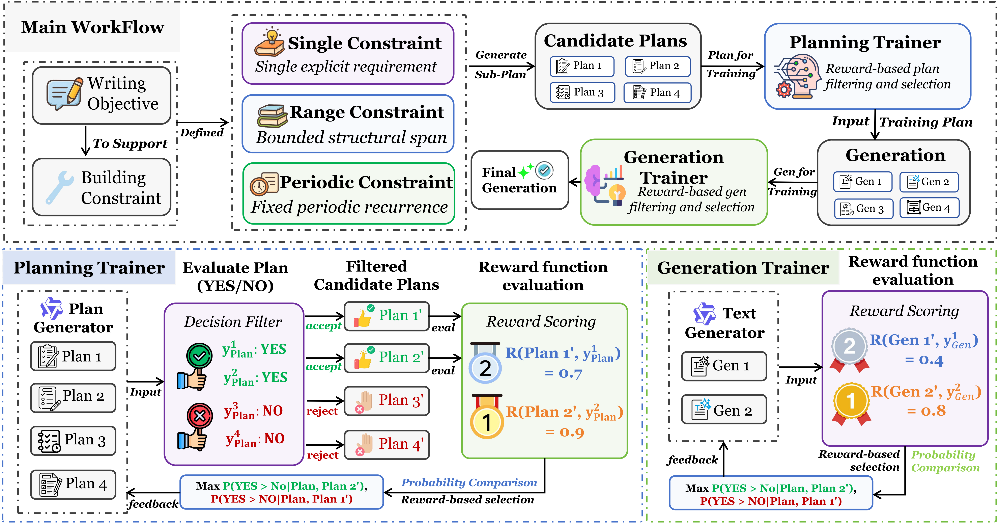

# LoopWeaver

Official resources of "LoopWeaver: Weaving Feedback Loops into Hierarchical Generation under Constraints". Yifan Zhu, Guanting Chen, Bing Wei, Haoran Luo. **NeurIPS 2026**.

## Overview

<div align="center">
  
</div>

Specifically, LoopWeaver first constructs and refines a constraint-aware hierarchical plan, followed by feasibility filtering to eliminate invalid plans. It then employs a  deterministic reward mechanism to construct preference pairs for two sequential DPO stages, optimizing planning and generation separately. At inference time, the trained policies are composed into a feed-forward "plan–filter–generate" workflow, enabling segment-by-segment generation conditioned on the corresponding sub-plans and running narrative.

## Implementation

### Install Environment

```bash
conda create -n LoopWeaver python=3.12 -y
conda activate LoopWeaver

# Install CUDA-specific packages first (match your CUDA version)
pip install torch==2.5.1 --index-url https://download.pytorch.org/whl/cu124
pip install vllm==0.7.1
# pip install deepspeed            # optional: multi-GPU DPO training

# Install the remaining dependencies
pip install -r requirements.txt
```

Start a vLLM server serving the base (or trained) model before running inference or data-generation steps.

### Training

Training consists of two independent DPO pipelines. The dataset is pre-split into `train`/`dev`, and every stage runs train and dev separately. DPO training uses the train preference pairs as training data and the dev pairs as evaluation data.

**One-click script:**

```bash
bash train_pipeline.sh              # planning + generation
# bash train_pipeline.sh planning   # planning only
# bash train_pipeline.sh generation # generation only
```

Before running, set the paths in the configuration block at the top of `train_pipeline.sh`:

```bash
MODEL_NAME="Qwen2.5-7B-Instruct"          # model name for llms.py steps
BASE_MODEL_PATH="/path/to/model"          # base model path for DPO training / LoRA merge
TRAIN_DATA="/path/to/datasets/train/data.json"
DEV_DATA="/path/to/datasets/dev/data.json"
OUT="/path/to/training_output"
```

**Planning pipeline (Plan_train):** `filter → reward → DPO data → DPO train → merge LoRA`

```bash
# 1. Generate + filter plans (train and dev)
python Planning_Module/Filter_example_use.py --model <model> --examples_file <train.json> --output_dir <planning/train_output>
python Planning_Module/Filter_example_use.py --model <model> --examples_file <dev.json>   --output_dir <planning/dev_output>

# 2. Compute rewards
python Planning_Module/Reward_example_use.py --input_file <planning/train_output/planning_results.json> --output_dir <planning/reward_train>

# 3. Build DPO preference pairs
python Planning_Module/DPO_example_use.py --input <planning/reward_train/reward_results.json> --output <planning/train/high_quality_pairs.json>

# 4. DPO training
python Planning_Module/DPOTrainer.py \
  --model_name_or_path <base> --train_data_path <planning/train/high_quality_pairs.json> \
  --eval_data_path <planning/dev/high_quality_pairs.json> --output_dir <planning/DPO_output>

# 5. Merge LoRA
python Generation_Module/merge_lora_model.py --base_model_path <base> --lora_weights_path <planning/DPO_output> --output_path <plan_train_merged>
```

**Generation pipeline (Gen_train):** `filter → generate → reward → DPO data → DPO train → merge LoRA`

```bash
# 1. Filter planning results (train and dev)
python Generation_Module/FilterResult.py --input_file <planning/train_output/planning_results.json> --output_file <generation/filter/train.json>

# 2. Generate content from the filtered plans
python Generation_Module/Generate.py --model <model> --input_file <generation/filter/train.json> --output_dir <generation/generate_train>

# 3. Compute generation rewards
python Generation_Module/Reward_example_use.py --input_file <generation/generate_train/generated_train.json> --output_dir <generation/reward_train>

# 4. Build DPO preference pairs (--format pairs --min_diff 0.5)
python Generation_Module/DPO_example_use.py --input <generation/reward_train/reward_results.json> --output <generation/train/high_quality_pairs.json> --format pairs --min_diff 0.5

# 5. DPO training
python Generation_Module/DPOTrainer.py \
  --model_name_or_path <base> --train_data_path <generation/train/high_quality_pairs.json> \
  --eval_data_path <generation/dev/high_quality_pairs.json> --output_dir <generation/DPO_output>

# 6. Merge LoRA
python Generation_Module/merge_lora_model.py --base_model_path <base> --lora_weights_path <generation/DPO_output> --output_path <gen_train_merged>
```

## Dataset Preparation

Datasets are stored under `datasets/{train,dev,test}/data.json`, each as a JSON list of examples. Each example has the following fields:

| Field | Description |
|---|---|
| `prompt` | The generation instruction (task description + constraints). |
| `type` | Task type: `Week`, `Menu Week`, `Floor`, or `Block`. |
| `number` | Number of units (e.g. 52 weeks). |
| `prefix` | The starting prefix of the output. |
| `checks_once` | One-time constraints, keyed by unit index. |
| `checks_range` | Range constraints (span multiple units), keyed by unit index. |
| `checks_periodic` | Periodic constraints, keyed by unit index. |

Place your own `train.json`/`dev.json`/`test.json` under [datasets/](./datasets/) and set the paths in `train_pipeline.sh` or pass `--dataset_dir` at inference time.

## Quick Start

### Inference: LoopWeaver mode

```bash
python main.py \
  --generator loopweaver \
  --plan_model <planning_model_name> \
  --gen_model <generation_model_name> \
  --dataset_dir /path/to/dataset.json \
  --output_dir /path/to/output.json
```

### Inference: base mode

```bash
python main.py \
  --generator base \
  --model <model_name> \
  --dataset_dir /path/to/dataset.json \
  --output_dir /path/to/output.json
```

| Argument | Description |
|---|---|
| `--generator` | `loopweaver` (plan → generate) or `base` (direct). Default `loopweaver`. |
| `--plan_model` | Planning model name (required for `loopweaver`). |
| `--gen_model` | Generation model name (required for `loopweaver`). |
| `--model` | Base model name (required for `base`). |
| `--dataset_dir` | Path to the input dataset. |
| `--output_dir` | Path to write the generated output. |

## Evaluation

### Constraint accuracy

```bash
python evaluation/eval_acc.py                       # all four methods
# python evaluation/eval_acc.py --method loopweaver # single method
# python evaluation/eval_acc.py --method baseline
# python evaluation/eval_acc.py --method gen-only
# python evaluation/eval_acc.py --method plan-only
```

Constraint accuracy is the fraction of task constraints satisfied in the output, judged by an LLM with a strict denominator (a missing unit counts as failure).

### Text quality

```bash
python evaluation/eval_quality.py                     # all four methods
# python evaluation/eval_quality.py --methods loopweaver
```

Text quality is judged on four dimensions — Narrative Continuity, Entity & Memory Persistence, Temporal Groundedness, and Affective Consistency — and converted to a 0–100 score via `(native 1..5 - 1) * 25`. Requires an API key (see `JUDGE_API_KEY`).
